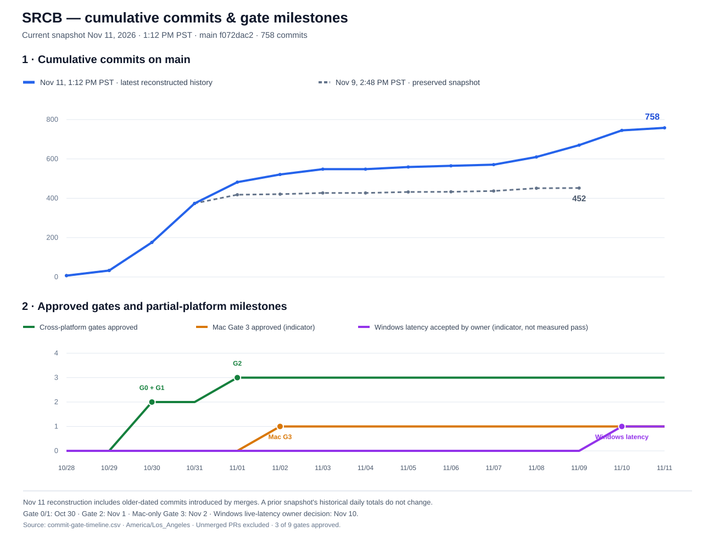
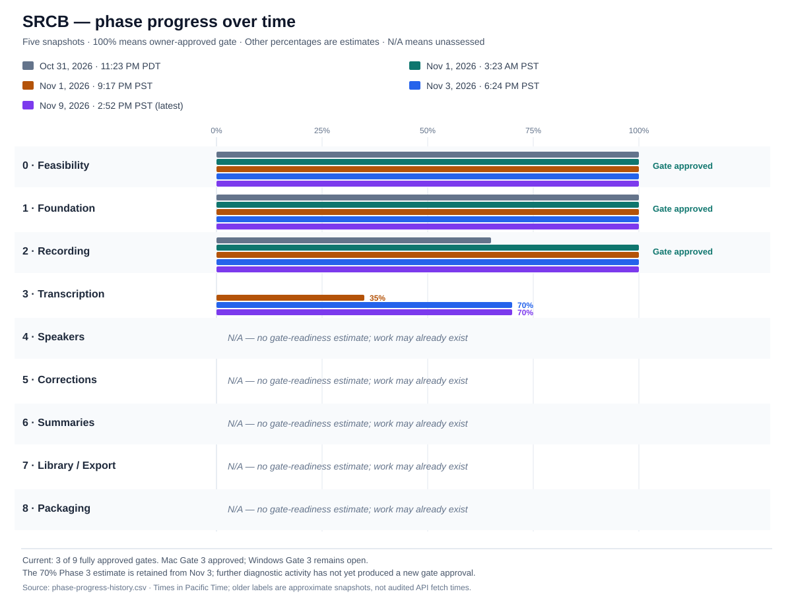

# SRCB phase progress history

**Purpose:** append-only historical snapshots of the *gate-validation chart* shared with the owner. The source of formal gate requirements is [Development Plan v2.0](../../dev-plan/Meeting%20Scribe%20-%20Development%20Plan%20(v2.0).md), not this report.

**Historical phase chart snapshot:** 2026-11-03 18:24 PST (America/Los_Angeles). Evidence inspected: `main` at `2abb0d54f1bead39d80398a31c9037cfb960a354` plus draft/stacked PRs as indicated. Snapshot time is the conversation's reported local time; it is not a separately logged second-precision GitHub API timestamp.

## Git commit counts and gate pass dates (November 9 refresh)



[Machine-readable daily timeline](commit-gate-timeline.csv) · [Current `main` commit history](https://github.com/raisinbran/scrb/commits/main/)

- **November 9, 2026, approximately 2:48 PM PST:** **452** commits reachable from `main` at pinned head [`a964d25e09da453d027d2bddfc9cdaccb5d15076`](https://github.com/raisinbran/scrb/commit/a964d25e09da453d027d2bddfc9cdaccb5d15076). GitHub's paginated `GET /repos/raisinbran/scrb/commits?sha=main&per_page=100&page=N` returned 452 unique commits across five pages (100, 100, 100, 100, 52); page six was empty.
- **Earlier November 3, 2026 snapshot:** 422 commits at `main` `2abb0d54` (reported in the earlier conversation). The increase is **30**. The current head history assigns **6** of its commits to November 3 whereas the earlier graph assigned **1**, since merges can introduce commits dated before they become reachable on `main`. **Do not confuse** a past observed snapshot count with a recomputed historical date-series.
- **Gate approvals:** Gates **0 and 1 on October 30**, Gate **2 on November 1** (all owner-approved, cross-platform); **macOS Gate 3 on November 2** as a *platform-only* approval. Windows Gate 3 is not yet approved and therefore there are only **3/9** fully approved gates.
- **Evidence:** [Gate 0](../../phase0/evidence/gate-0.md), [Gate 1](../gates/gate-1.md), [Gate 2](../gates/gate-2.md), [Mac Gate 3 approval on PR #47](https://github.com/raisinbran/scrb/blob/1eda6eb0fae5b672e23250a3d0782da24d4e8624/docs/gates/gate-3-macos.md), and the unapproved Windows [retest PR #74](https://github.com/raisinbran/scrb/pull/74).
- **Interpretation:** commit totals include every reachable commit (including merge commits, tests and documentation), but exclude unmerged PRs. Daily grouping uses each commit's **committer timestamp** in `America/Los_Angeles`. The timeline is **not** a measurement of feature completion or person-hours.

**Update practice:** Do not overwrite the November 9 observations. For each later report, append another complete dated `snapshot_time_pacific` series to `commit-gate-timeline.csv`, pin its `snapshot_main_head`, and update the SVG to display the new snapshot with clear dates and gate distinctions. If the current `main` history has changed through branch merges, explain why its retrospective date counts differ from prior snapshots.

## Historical chart and data

**Latest phase snapshot:** November 9, 2026, 2:52 PM PST (America/Los_Angeles), with `main` pinned at `a964d25e09da453d027d2bddfc9cdaccb5d15076`. The earlier November 3 phase assessment and the separate November 9 commit/gate timeline remain preserved, not replaced.



The chart uses five dated colors for the historical estimates and the November 9 update. Blank/unassessed categories are not graphed as measured 0% completion. The archived numeric zeroes are retained for continuity and labeled `not_assessed` in the CSV.

The source-of-truth chart data is [phase-progress-history.csv](phase-progress-history.csv). **Do not retroactively overwrite** previous estimates; append subsequent observations. The times on the first three rows were shown in earlier conversation charts and are *approximate labels*, not audited fetch times. Oct 31/Nov 1 spans a Pacific daylight-saving switch.

| Phase / gate validation | Oct 31 11:23 PM PDT | Nov 1 3:23 AM PST | Nov 1 9:17 PM PST | Nov 3 6:24 PM PST | Nov 9 2:52 PM PST |
| --- | ---: | ---: | ---: | ---: | ---: |
| 0 — Feasibility | 100% | 100% | 100% | 100%  100% |
| 1 — Foundation | 100% | 100% | 100% | 100%  100% |
| 2 — Recording | 65% | 100% | 100% | 100%  100% |
| 3 — Transcription | 0%† | 0%† | 35% | **70%**  **70%** |
| 4 — Speakers | 0%† | 0%† | 0%† | 0%†  0%† |
| 5 — Corrections and vocabulary | 0%† | 0%† | 0%† | 0%†  0%† |
| 6 — Summaries | 0%† | 0%† | 0%† | 0%†  0%† |
| 7 — Library and export | 0%† | 0%† | 0%† | 0%†  0%† |
| 8 — Packaging and hardening | 0%† | 0%† | 0%† | 0%†  0%† |
| **Formally approved gates** | **2/9** | **3/9** | **3/9** | **3/9** | **3/9** |

† **Unassessed:** zero is a historical chart placeholder, *not* an observation of 0% engineering work or no progress. The CSV's corresponding `phase_N_assessment_status` is `not_assessed`; consumers should treat that cell as missing data in percentage analyses. Formally approved gates and subjective readiness estimates have different meanings.

### Historical November 3 snapshot, bar view (retained)

Each `#` is approximately 5 percentage points. This is a **single latest-snapshot bar chart**, not a substitute for the four-column historical chart above.

```text
Phase 0  #################### 100  approved
Phase 1  #################### 100  approved
Phase 2  #################### 100  approved
Phase 3  ##############        70  estimated, split Mac/Windows
Phase 4                          0  gate unapproved; draft work exists
Phase 5                          0  gate unapproved; draft work exists
Phase 6                          0  gate unapproved; preliminary code exists
Phase 7                          0  gate unapproved; preliminary code exists
Phase 8                          0  gate unapproved; preliminary code exists
```

## November 9 phase assessment

**Gate-validation status:** Gates 0–2 approved; Mac Gate 3 owner-approved November 2; Windows Gate 3 still open. **3/9 fully approved gates.** Latest checked `main` [`a964d25e`](https://github.com/raisinbran/scrb/commit/a964d25e09da453d027d2bddfc9cdaccb5d15076). This adds a **new fifth bar series** without rewriting the original four.

- **Phase 3 = 70% (estimated, unchanged).** Additional Windows timing/observer validation and retest planning are substantial but are not a new accepted cross-platform pass. The [Windows integration branch `64e3d03`](https://github.com/raisinbran/scrb/commit/64e3d03fe318216210b69ca3ee1f9ada3ddc3bdf) still describes a draft, not-frozen evidence surface; [PR #74 `6b75b6f`](https://github.com/raisinbran/scrb/pull/74) remains unapproved for the scored retest. Do not increase a subjective readiness estimate merely for more iterations without a new acceptance result.
- **Phase 4/5 = N/A (unassessed gate readiness).** [PR #48](https://github.com/raisinbran/scrb/pull/48) and stacked [PR #50](https://github.com/raisinbran/scrb/pull/50) are merged into their respective stacked branches; [PR #58](https://github.com/raisinbran/scrb/pull/58) adds draft voice-profile recognition. None establishes Gate 4 or 5 approval, and the timeline does not assume these changes are in `main`.
- **Phases 6–8 = N/A.** Code and preliminary work may exist, but no independently justified gate-readiness percentage is supplied.

**Pinned inputs for this snapshot:** `main@a964d25e09da453d027d2bddfc9cdaccb5d15076`; `PR42@2d1f8150cb68d56ec3fc842f1709f276f124ef55`; `PR47@1eda6eb0fae5b672e23250a3d0782da24d4e8624`; `PR48@1afc4e0b88356c412642261f72a2ca9c5865e187`; `PR50@6cf09396b5f42154e7039f7fd1cd3d7dda576c91`; `PR58@111cb1e74ea0557d3a19cded1bda373cca53e361`; `PR74@6b75b6f5d19cc37834bf20717780bbd0c8a8a07f`; `windows-gate3-integration@64e3d03fe318216210b69ca3ee1f9ada3ddc3bdf`. These match the machine-readable CSV source-ref field. The displayed time is minute-rounded from a current local time lookup; historical snapshot labels remain approximate.

## Immutable snapshot evidence (November 3)

The GitHub PR revisions below were verified against the November 3 snapshot and must remain pinned for reproducibility even if the branches change later. These are **source revisions**, not an assertion that stacked PR work has merged to `main`.

| Source | Pinned revision | Used to support |
| --- | --- | --- |
| `main` | [`2abb0d54f1bead39d80398a31c9037cfb960a354`](https://github.com/raisinbran/scrb/commit/2abb0d54f1bead39d80398a31c9037cfb960a354) | Approved baseline, gate policy |
| PR #42 | [`e85eefed98298221cf921ba62f9b2e3e325a54bd`](https://github.com/raisinbran/scrb/commit/e85eefed98298221cf921ba62f9b2e3e325a54bd) | Gate 3 integrated candidate and remaining limits |
| PR #47 | [`1eda6eb0fae5b672e23250a3d0782da24d4e8624`](https://github.com/raisinbran/scrb/commit/1eda6eb0fae5b672e23250a3d0782da24d4e8624) | Mac Gate 3 owner-approval record |
| PR #48 | [`b0a0127cfe1a83b9f8a32911f6271fbb7405aa34`](https://github.com/raisinbran/scrb/commit/b0a0127cfe1a83b9f8a32911f6271fbb7405aa34) | Early Phase 4/5 real routing |
| PR #50 | [`242167864166d27278db7e8c2b4fe4f7444bd625`](https://github.com/raisinbran/scrb/commit/242167864166d27278db7e8c2b4fe4f7444bd625) | Early Phase 4 speaker-split persistence |

The same references are encoded in the latest CSV row's `source_refs` field. Earlier observations lack fully audited PR pins and are retained explicitly as historical estimates.

## November 3 assessment

- **Gates 0–2:** approved. Gate 2 was [closed by owner](../gates/gate-2.md) on 2026-11-01, with documented exceptions.
- **Gate 3:** **not approved overall**. macOS portion is owner-approved at `e85eefe` (see [PR #47](https://github.com/raisinbran/scrb/pull/47), draft gate document). Windows still lacks accepted final-pass decoder/toolchain evidence, paired live/final accuracy and timing, four-hour live acceptance, recording-activation target, and full import/playback and cancellation acceptance; see [PR #42](https://github.com/raisinbran/scrb/pull/42). The **70%** bar is a **subjective approximation**, up from the prior chart's 35%, not 70% of tests or code completed. Mac approval alone does not grant the cross-platform gate.
- **Phases 4 and 5:** meaningful early implementation in [PR #48](https://github.com/raisinbran/scrb/pull/48) (real meeting action routing, edit/event forwarding, import privacy reminder) and stacked [PR #50](https://github.com/raisinbran/scrb/pull/50) (atomic persisted speaker splits; Mac native check, 1,009 unit tests passed). Both remain draft/not gate-approved, and implementation is not represented by 0% gate-validation bars.
- **Other phases:** preliminary code and UI work exist; absence of gate approval must not be mistaken for absence of development.
- **Branch vs main:** current main is largely Gate 2 + selected UI/docs. Large pieces of later work are **unmerged** draft/stacked PRs. This chart deliberately counts inspected PR evidence but never equates it with merged/released software.

## Methodology and update rule

1. **Approval is binary:** 100% only when the owner has formally approved the phase gate, even with explicit recorded exceptions. Otherwise 0–99% is a subjective *progress toward gate acceptance* estimate, not implementation percentage. For unassessed phases, archived 0 means **no gate-validation percentage established**, not literally no progress. Every phase has a `phase_N_assessment_status` column: `approved`, `estimated` or `not_assessed`. **Do not chart `not_assessed` as a measured zero**.
2. Do not interpret average of these bars as weighted overall program completion. **Approved gates count** is the reliable headline: 3/9 as of this snapshot.
3. Record local display time (Pacific, with PST/PDT and UTC offset when available), timezone, snapshot provenance and pinned commit/PR references. Never pass off approximate historic chat chart labels as exact API pull times.
4. Review `main`, relevant unmerged PR heads, gate evidence and owner decisions. Distinguish native physical runs from cloud CI, docs and agent-reported outcomes. Do not silently promote a platform-specific PASS into an overall gate PASS.
5. Append new rows to the CSV and add a dated assessment to this document; retain every earlier snapshot and reasons for changes. Update the comparison SVG alongside new CSV rows so the published chart matches the archive. If methodology changes, create a separately named metric/series instead of rewriting existing values.
6. This report is documentation only; it does not authorize merging PRs, deleting test recordings, changing owner criteria or approving gates. Gate evidence is governed by [evidence-retention-policy.md](../gates/evidence-retention-policy.md).
