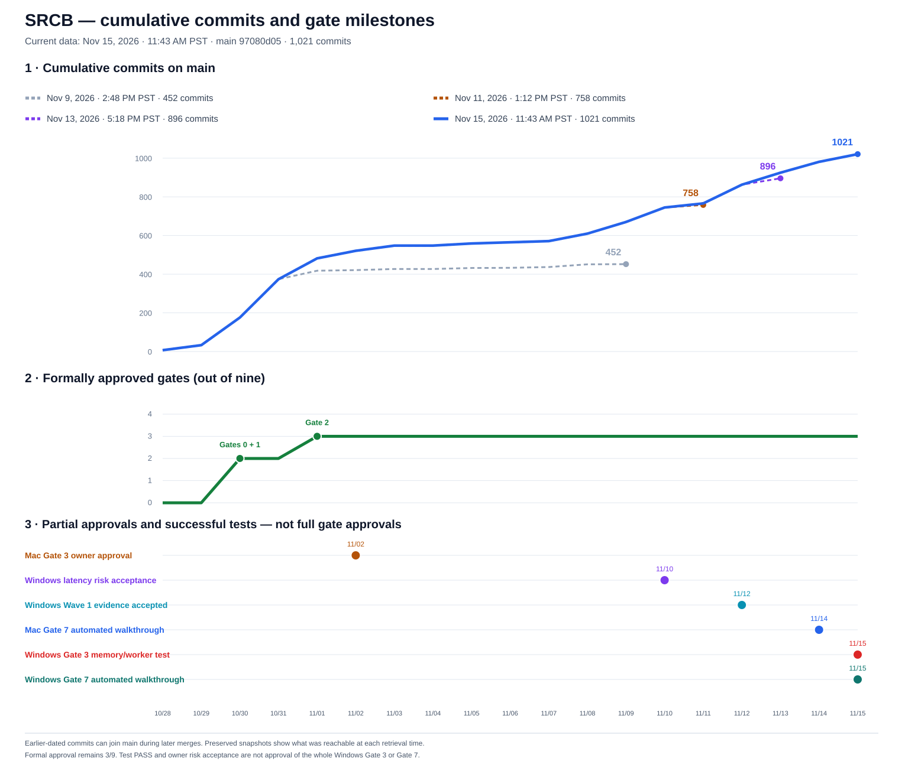
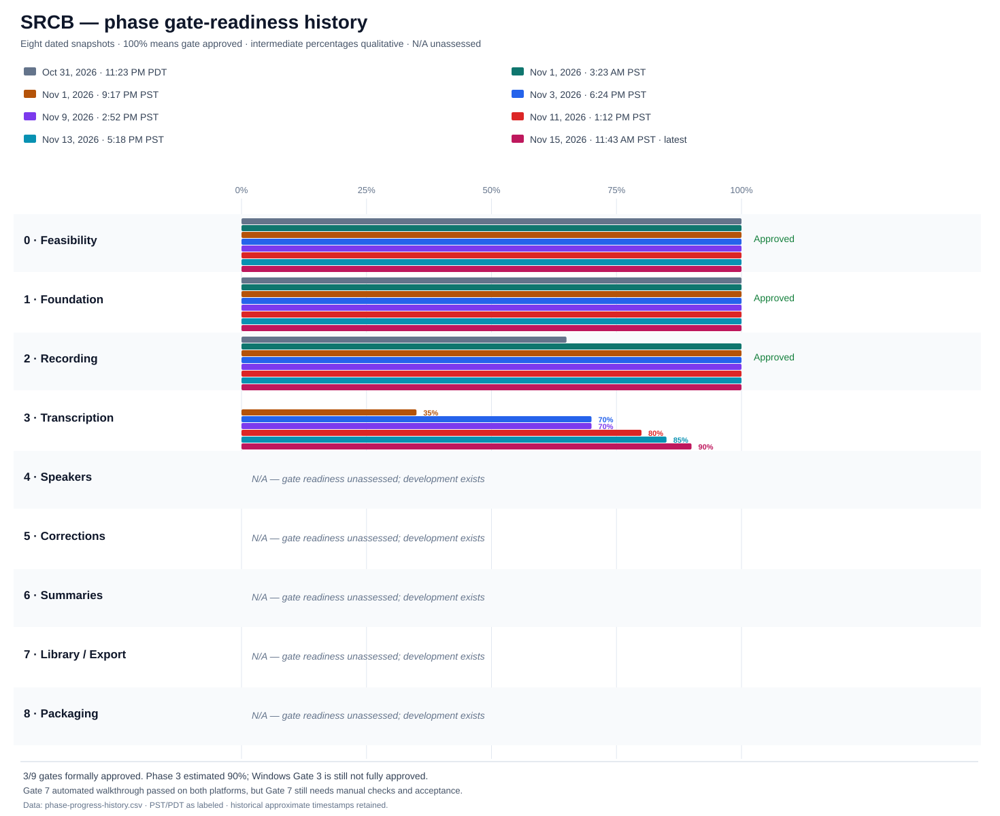

# SRCB phase progress history

**Purpose:** append-only historical snapshots of the *gate-validation chart* shared with the owner. The source of formal gate requirements is [Development Plan v2.0](../../dev-plan/Meeting%20Scribe%20-%20Development%20Plan%20(v2.0).md), not this report.

**Historical phase chart snapshot:** 2026-11-03 18:24 PST (America/Los_Angeles). Evidence inspected: `main` at `2abb0d54f1bead39d80398a31c9037cfb960a354` plus draft/stacked PRs as indicated. Snapshot time is the conversation's reported local time; it is not a separately logged second-precision GitHub API timestamp.

## Git commit counts and gate pass dates



[Machine-readable daily timeline](commit-gate-timeline.csv) · [Current `main` commit history](https://github.com/raisinbran/scrb/commits/main/)

### November 22, 2026 (current)

- **November 22, 2026, 4:25 PM PST:** **1,112** unique reachable commits at pinned `main` [`b75bd7f42`](https://github.com/raisinbran/scrb/commit/b75bd7f42ec3540751baa31ae59bf0c9485bb059). Eleven complete GitHub API commit pages (11 × 100), page 12 had 12, and page 13 was empty. **+91** from the observed Nov 15 snapshot of 1,021; the newly reconstructed Nov 15 date total is 1,029, because subsequent merges can introduce older-dated commits. This is a reconstruction from commit *committer dates*, not a historical read of what was in `main` on each prior calendar day.
- **Formal gates remain 3/9:** Gate 0/1 owner-approved Oct 30, Gate 2 Nov 1; macOS Gate 3 separately approved Nov 2. No documented whole Windows Gate 3 or Gates 4–8 owner approval was found in the current [Development Plan v2.0](../../dev-plan/Meeting%20Scribe%20-%20Development%20Plan%20(v2.0).md) and gate records. Windows latency risk acceptance, Wave 1 evidence substitutions, Windows worker-kill PASS and Gate 7 automated walkthroughs are retained as **separate** previously dated milestones, not new formal gate approvals.
- **Installed acceptance is distinct from source/CI progress:** merged [PR #438](https://github.com/raisinbran/scrb/pull/438) introduced the V1 installed-acceptance matrix with **0/28 Mac+Windows evidence cells VERIFIED**, i.e. not yet tested to closure, **not 28 measured failures**. Draft [PR #445](https://github.com/raisinbran/scrb/pull/445) records M1 installed **0/15** and V1 installed **0/28** NOT VERIFIED. PR #445 remains a *draft/unmerged handoff*, not production acceptance. Separate merged source fixes for simulated Settings actions and macOS profile safety likewise do not prove packaged/installed behavior.
- **Phase 3 readiness estimate stays at 90%.** It remains a qualitative historical continuity value; additional merged source, documentation and CI changes do not by themselves establish increased gate-readiness or owner approval. Phases 4–8 remain `not_assessed` numerically; especially, implementation progress and acceptance evidence must be tracked separately.
- **Archived graphics:** [Nov 9](commit-gate-timeline-20261109.svg), [Nov 11](commit-gate-timeline-20261111.svg), [Nov 13](commit-gate-timeline-20261113.svg) and [Nov 15](commit-gate-timeline-20261115.svg) cumulative/gate timelines; [Nov 9](phase-progress-comparison-20261109.svg), [Nov 11](phase-progress-comparison-20261111.svg), [Nov 13](phase-progress-comparison-20261113.svg), and [Nov 15](phase-progress-comparison-20261115.svg) phase bar charts. Older CSV rows and approvals are unchanged.

### November 15, 2026 (preserved snapshot)

- **November 15, 2026, 11:43 AM PST:** **1,021** commits reachable from pinned `main` at [`97080d05`](https://github.com/raisinbran/scrb/commit/97080d05ff8c796eb0080e013095173e387ecd45), confirmed by 11 paginated GitHub API responses (10 × 100 + 21), with page 12 empty. **+125** since the actual November 13 observation (896). The latest reconstruction assigns 925 commits through November 13, rather than the previously observed 896, because commits can become newly reachable on `main` with earlier timestamps after merges.
- **Formal gates still 3/9:** Gates 0/1 approved October 30, Gate 2 approved November 1. Mac Gate 3 was approved November 2. Windows live latency owner-risk-accepted November 10 and Wave 1 evidence substitutions accepted November 12 remain partial criteria, not measured/full Gate 3 approval.
- **New Windows Gate 3 evidence:** [memory and live-worker-kill test](../gates/gate-3-windows-memory-worker-kill-results-20261115.md) recorded **PASS** on BCHEN-W10: 1,405 MiB peak working set, 1,801 MiB private bytes, all 112 pre-kill audio chunks unchanged, and successful restart. One ~7-minute development-build run; final-pass memory after watcher stop was not sampled. This is **not full Windows Gate 3 approval**. [Remaining-criteria audit](../handoffs/windows-gate3-remaining-20261115.md) identifies decisions on accuracy, import evidence and speed; its November 15 addendum explicitly treats the reported owner decisions as unverified until recorded.
- **Gate 7 evidence on both platforms:** [macOS](../gates/gate-7-mac-walkthrough-20261114.md) and [Windows](../gates/gate-7-windows-walkthrough-20261115.md) automated walkthroughs each passed 2 tests (import/search/export/delete; auto-delete). Manual Word/PDF layout and Settings/delete wording checks, along with difficult deletion and Windows file-locking cases, remain. **Gate 7 is not owner-approved.**
- **Other gates remain open:** Gate 5 [persistence checks](../gates/gate-5-persistence-evidence-20261114.md) passed 35/35 but the learned-term audio-accuracy requirement is still unmet. Gate 6 [held-out recall](../gates/gate-6-summary-eval.md) remains 68% versus 80% required; self-judged precision is 32% with uncertain accuracy. Gate 8 still needs its 8-hour and release criteria; [PR #318](https://github.com/raisinbran/scrb/pull/318) reports a failed Mac Gate 8 run but that report is not a complete approved gate assessment.
- **Archives:** [November 9](commit-gate-timeline-20261109.svg), [November 11](commit-gate-timeline-20261111.svg), and [November 13](commit-gate-timeline-20261113.svg) commit/gate charts; corresponding [November 9](phase-progress-comparison-20261109.svg), [November 11](phase-progress-comparison-20261111.svg), and [November 13](phase-progress-comparison-20261113.svg) phase bars. The original daily observations and prior phase estimates remain in both append-only CSVs.

### November 13, 2026 (preserved snapshot)

- **November 13, 2026, 5:18 PM PST:** **896** unique commits reachable from pinned `main` at [`d3824f94`](https://github.com/raisinbran/scrb/commit/d3824f94c632632dfbfb3acbd6057d0166b7d337). GitHub's commit API returned 100 commits on each of pages 1–8, 96 on page 9, and no entries on page 10. **+138 commits** since the observed November 11 snapshot (758), including earlier-dated commits newly reachable following merges. Today's reconstructed November 11 date total is 766, not the prior snapshot's 758.
- **Full gate count remains 3/9.** Mac Gate 3 was approved November 2. On November 10 the owner accepted the Windows live-latency criterion by risk decision (not a measured protocol pass). On November 12 the owner accepted two [Windows Wave 1 playback/capture evidence substitutions](../gates/gate-3-windows-wave1-evidence-owner-decision-20261112.md); neither decision alone marks the full Windows Gate 3 as passed.
- **November 13 phase-gate policy:** [AGENTS.md](../../AGENTS.md) now explicitly relaxes sequential gate prerequisites for parallel phase development, and Windows/Mac gate evidence is not required for work outside M1. This is not retrospective approval of unpassed gates.
- **Implementation advancing without formal gate approval:** [PR #185](https://github.com/raisinbran/scrb/pull/185) merged real summary generation (Phase 6); [PR #161](https://github.com/raisinbran/scrb/pull/161) merged packaged macOS app work (Phase 8). Neither establishes Gate 6 or Gate 8 approval.
- **Archives:** [November 9 commit/gate chart](commit-gate-timeline-20261109.svg), [November 11 commit/gate chart](commit-gate-timeline-20261111.svg), [November 9 phase bar chart](phase-progress-comparison-20261109.svg), and [November 11 phase bar chart](phase-progress-comparison-20261111.svg) remain separate. The current SVGs are refreshed, and both source CSVs preserve all dated snapshots.

### November 11, 2026 (preserved snapshot)

- **November 11, 2026, 1:12 PM PST:** **758** unique commits reachable from pinned `main` at [`f072dac2`](https://github.com/raisinbran/scrb/commit/f072dac254fd95d033dd35644bd85b1bea9b98f9). Eight paginated GitHub API pages yielded 100+100+100+100+100+100+100+58 unique commits; page 9 was empty. **+306 commits** since the November 9 observed snapshot (452); these include old-dated commits later merged into `main`, so historical date counts have changed in the reconstruction.
- **Full gate approvals remain 3/9:** Gate 0 and Gate 1 (Oct 30), Gate 2 (Nov 1). macOS Gate 3 approval (Nov 2) is a platform milestone. The [signed Nov 10 Windows live-latency decision](../gates/gate-3-windows-latency-owner-decision-record-20261110.md) is **owner risk acceptance for latency only**, explicitly **not** a measured protocol PASS or a full Windows Gate 3 approval. Other Windows criteria remain open.
- **Major merged work:** [PR #42](https://github.com/raisinbran/scrb/pull/42) Mac Gate 3 integration, [PR #58](https://github.com/raisinbran/scrb/pull/58) verified-profile recognition, [PR #64](https://github.com/raisinbran/scrb/pull/64) focus/zoom improvements, and [PR #85](https://github.com/raisinbran/scrb/pull/85) live speaker attribution slice 1. These changes contribute commits but do not by themselves establish a new approved phase gate.
- **Old charts preserved:** [November 9 commit/gate SVG](commit-gate-timeline-20261109.svg) and [November 9 phase bar SVG](phase-progress-comparison-20261109.svg) are immutable archival copies. The primary SVGs now show the November 11 data, retaining historic rows/series; CSV history preserves both original dated observations and the new reconstructed history.

### November 9, 2026 (preserved snapshot)

- **November 9, 2026, approximately 2:48 PM PST:** **452** commits reachable from `main` at pinned head [`a964d25e09da453d027d2bddfc9cdaccb5d15076`](https://github.com/raisinbran/scrb/commit/a964d25e09da453d027d2bddfc9cdaccb5d15076). GitHub's paginated `GET /repos/raisinbran/scrb/commits?sha=main&per_page=100&page=N` returned 452 unique commits across five pages (100, 100, 100, 100, 52); page six was empty.
- **Earlier November 3, 2026 snapshot:** 422 commits at `main` `2abb0d54` (reported in the earlier conversation). The increase is **30**. The current head history assigns **6** of its commits to November 3 whereas the earlier graph assigned **1**, since merges can introduce commits dated before they become reachable on `main`. **Do not confuse** a past observed snapshot count with a recomputed historical date-series.
- **Gate approvals:** Gates **0 and 1 on October 30**, Gate **2 on November 1** (all owner-approved, cross-platform); **macOS Gate 3 on November 2** as a *platform-only* approval. Windows Gate 3 is not yet approved and therefore there are only **3/9** fully approved gates.
- **Evidence:** Gate 0 (its evidence folder is no longer in the repository), [Gate 1](../gates/gate-1.md), [Gate 2](../gates/gate-2.md), [Mac Gate 3 approval on PR #47](https://github.com/raisinbran/scrb/blob/1eda6eb0fae5b672e23250a3d0782da24d4e8624/docs/gates/gate-3-macos.md), and the unapproved Windows [retest PR #74](https://github.com/raisinbran/scrb/pull/74).
- **Interpretation:** commit totals include every reachable commit (including merge commits, tests and documentation), but exclude unmerged PRs. Daily grouping uses each commit's **committer timestamp** in `America/Los_Angeles`. The timeline is **not** a measurement of feature completion or person-hours.

**Update practice:** Do not overwrite the November 9, November 11, November 13, November 15 or November 22 observations. For each later report, append another complete dated `snapshot_time_pacific` series to `commit-gate-timeline.csv`, pin its `snapshot_main_head`, and update the SVG to display the new snapshot with clear dates and gate distinctions. If the current `main` history has changed through branch merges, explain why its retrospective date counts differ from prior snapshots.

## Historical chart and data

**Latest phase snapshot:** November 22, 2026, 4:25 PM PST (America/Los_Angeles), pinned to `main` at `b75bd7f42ec3540751baa31ae59bf0c9485bb059`. The prior eight phase snapshots and independent commit/gate histories are preserved, not replaced.



The chart uses nine dated colors for historic phase estimates through the November 22 update. Blank/unassessed categories are not graphed as measured 0% completion. The archived numeric zeroes are retained for continuity and labeled `not_assessed` in the CSV.

The source-of-truth chart data is [phase-progress-history.csv](phase-progress-history.csv). **Do not retroactively overwrite** previous estimates; append subsequent observations. The times on the first three rows were shown in earlier conversation charts and are *approximate labels*, not audited fetch times. Oct 31/Nov 1 spans a Pacific daylight-saving switch.

| Phase / gate validation | Oct 31 11:23 PM PDT | Nov 1 3:23 AM PST | Nov 1 9:17 PM PST | Nov 3 6:24 PM PST | Nov 9 2:52 PM PST | Nov 11 1:12 PM PST | Nov 13 5:18 PM PST | Nov 15 11:43 AM PST | Nov 22 4:25 PM PST |
| --- | ---: | ---: | ---: | ---: | ---: | ---: | ---: | ---: | ---: |
| 0 — Feasibility | 100% | 100% | 100% | 100% | 100% | 100% | 100% | 100% | 100% |
| 1 — Foundation | 100% | 100% | 100% | 100% | 100% | 100% | 100% | 100% | 100% |
| 2 — Recording | 65% | 100% | 100% | 100% | 100% | 100% | 100% | 100% | 100% |
| 3 — Transcription | 0%† | 0%† | **35%** | **70%** | **70%** | **80%** | **85%** | **90%** | **90%** |
| 4 — Speakers | 0%† | 0%† | 0%† | 0%† | 0%† | 0%† | 0%† | 0%† | 0%† |
| 5 — Corrections and vocabulary | 0%† | 0%† | 0%† | 0%† | 0%† | 0%† | 0%† | 0%† | 0%† |
| 6 — Summaries | 0%† | 0%† | 0%† | 0%† | 0%† | 0%† | 0%† | 0%† | 0%† |
| 7 — Library and export | 0%† | 0%† | 0%† | 0%† | 0%† | 0%† | 0%† | 0%† | 0%† |
| 8 — Packaging and hardening | 0%† | 0%† | 0%† | 0%† | 0%† | 0%† | 0%† | 0%† | 0%† |
| **Formally approved gates** | **2/9** | **3/9** | **3/9** | **3/9** | **3/9** | **3/9** | **3/9** | **3/9** | **3/9** |

† **Unassessed:** zero is a historical chart placeholder, *not* an observation of 0% engineering work or no progress. The CSV's corresponding `phase_N_assessment_status` is `not_assessed`; consumers should treat that cell as missing data in percentage analyses. Formally approved gates and subjective readiness estimates have different meanings.

### Historical November 3 snapshot, bar view (retained)

Each `#` is approximately 5 percentage points. This is an **archived November 3 single-snapshot text bar chart**; the nine-series visual comparison above is the current chart.

```text
Phase 0  #################### 100  approved
Phase 1  #################### 100  approved
Phase 2  #################### 100  approved
Phase 3  ##############        70  estimated, split Mac/Windows
Phase 4                          0  gate unapproved; draft work exists
Phase 5                          0  gate unapproved; draft work exists
Phase 6                          0  gate unapproved; preliminary code exists
Phase 7                          0  gate unapproved; preliminary code exists
Phase 8                          0  gate unapproved; preliminary code exists
```

## November 22 phase assessment

**Gate validation:** Gates 0–2 formally approved, macOS-only Gate 3 approved; Windows Gate 3 whole-platform approval and Gates 4–8 remain open, so **3/9 complete gates**. No existing gate or test is reclassified as passed because a source PR merged.

- **Phase 3 = 90% (unchanged subjective readiness).** No new Windows whole-Gate 3 acceptance was located. Distinguish the Windows risk-accepted live latency, Wave 1 substitutions, and short development-build worker-kill result from full source/installed-app acceptance. Do not increase estimated readiness without new gate evidence.
- **Phases 4–8 = N/A (numerically unassessed).** Several implementation slices have merged, including source-level Settings truthfulness, model downloads and installation tooling. The 0 fields retained for historical schema compatibility are `not_assessed`, not estimates of zero engineering progress.
- **M1 and V1 installed acceptance:** [PR #438](https://github.com/raisinbran/scrb/pull/438) has merged an acceptance matrix; all 28 Mac/Windows V1 installed-verification cells remain NOT VERIFIED at that snapshot. [Draft PR #445](https://github.com/raisinbran/scrb/pull/445) reports M1 0/15 and V1 0/28. These are evidence-coverage counts, **not PASS/FAIL test outcomes**. Source, CI, local testing and installed acceptance must not be conflated.
- **Pinned evidence:** `main@b75bd7f42ec3540751baa31ae59bf0c9485bb059`, merged [PR #438](https://github.com/raisinbran/scrb/pull/438) `584639f0`, and draft [PR #445](https://github.com/raisinbran/scrb/pull/445) `92e310a2` (unmerged documentation). See latest phase CSV row for full source revisions.

## November 15 phase assessment

**Gate validation:** Gates 0–2 fully approved; macOS Gate 3 approved on its platform. Windows Gate 3, and Gates 4–8, still lack formal owner approval. **3/9 fully approved gates**, unchanged.

- **Phase 3 = 90% (subjective readiness, +5 points from November 13).** The increase reflects passing Windows memory and live-worker-kill checks at [the pinned W10 run](../gates/gate-3-windows-memory-worker-kill-results-20261115.md), and the previous Windows latency/Wave 1 owner risk decisions. It is **not a measured percent-complete or an approval**, and the run's short duration and incomplete final-pass memory coverage remain limitations. The remaining Windows decisions/overall gate closure still require documented acceptance.
- **Phase 4 = N/A (not assessed numerically).** Live speaker attribution and voice-profile work have advanced, but Gate 4 accuracy, reversible identities and privacy criteria are not certified.
- **Phase 5 = N/A.** Persistence test evidence is encouraging (35/35), but improved recognition with learned vocabulary on real audio is unproven and a prior evaluation found inert hints.
- **Phase 6 = N/A.** The held-out summary evaluation misses the required recall threshold (68% against 80%), with 32% self-judged precision of unknown accuracy; real summary code does not mean Gate 6 has passed.
- **Phase 7 = N/A.** Automated Mac and Windows Gate 7 walkthroughs now pass, with manual export layout, Settings UI and hard deletion conditions still pending; no owner gate approval.
- **Phase 8 = N/A.** Packaged app development continues; the Mac 8-hour run was reported as FAIL on an open recovery-documentation PR, and formal hardening evidence is still required.
- **Pinned snapshot:** `main@97080d05ff8c796eb0080e013095173e387ecd45`, W10 [PR #313](https://github.com/raisinbran/scrb/pull/313), Windows [Gate 7 PR #304](https://github.com/raisinbran/scrb/pull/304), [Gate 8 criterion PR #263](https://github.com/raisinbran/scrb/pull/263), and [Gate 6 result PR #256](https://github.com/raisinbran/scrb/pull/256). The unmerged recovery note [PR #318](https://github.com/raisinbran/scrb/pull/318) is explicitly noted as provisional. Full head IDs are in the November 15 phase CSV record.

## November 13 phase assessment

**Gate validation:** Gate 0–2 formally approved, Mac Gate 3 approved on its platform, but Windows Gate 3 as a whole still lacks formal approval; overall **3/9 gates**. This report reflects the owner's relaxed sequencing policy of November 13: phases can move in parallel without treating pending gates as closed.

- **Phase 3 = 85% (subjective readiness, +5 points since November 11).** This modest estimate reflects the November 12 owner acceptance of two Windows Wave 1 evidence substitutions, additional final-pass work and smaller gaps in the Windows Gate 3 checklist. It is *not a measured completion percentage*. The November 10 latency acceptance was a risk decision, not a measured pass, and the full Windows Gate 3 remains open.
- **Phase 4/5 = N/A (not numerically assessed).** Speaker attribution, voice profiles and correction features have substantial source code, but no Gate 4 or Gate 5 acceptance. The historical 0 placeholders are not evidence of zero development.
- **Phase 6 = N/A (not numerically assessed).** [PR #185](https://github.com/raisinbran/scrb/pull/185) has merged the first real summary generation/cancellation backend slice, but Gate 6 requires independent evaluation against recall, precision and source-link thresholds. Do not infer a percentage from the existence of an implementation slice.
- **Phase 8 = N/A (not numerically assessed).** [PR #161](https://github.com/raisinbran/scrb/pull/161) added the packaged macOS app; Windows packaging [PR #188](https://github.com/raisinbran/scrb/pull/188) remains in progress. Gate 8 requires release-grade cross-platform acceptance, not merely packaging source code.
- **Snapshot source pins:** `main@d3824f94c632632dfbfb3acbd6057d0166b7d337`, [PR #153](https://github.com/raisinbran/scrb/pull/153) `241f52dc` for phase gate policy, [PR #161](https://github.com/raisinbran/scrb/pull/161) `daab84df` for macOS packaging, and [PR #185](https://github.com/raisinbran/scrb/pull/185) `3ed6515e` for summaries, plus both dated Windows owner decisions. See the November 13 CSV row for full head hashes.

## November 11 phase assessment

**Gate-validation snapshot:** Gates 0–2 approved on both platforms; Mac Gate 3 approved; Windows Gate 3 still open. **3/9 fully approved gates**, unchanged.

- **Phase 3 = 80% (qualitative estimate, +10 percentage points from November 9).** The updated estimate reflects major [Mac Gate 3 integrated-stack merge, PR #42](https://github.com/raisinbran/scrb/pull/42) and the [November 10 Windows live-latency owner risk acceptance](../gates/gate-3-windows-latency-owner-decision-record-20261110.md). It is **not a measured progress ratio** and does not claim the Windows live path is fixed or the overall gate passed. Remaining Windows Gate 3 criteria still require their own acceptance.
- **Phase 4 and Phase 5 = N/A (unassessed numeric gate readiness), not zero implementation.** Real meeting and speaker-editing work, verified profile recognition [PR #58](https://github.com/raisinbran/scrb/pull/58) and live speaker attribution slice 1 [PR #85](https://github.com/raisinbran/scrb/pull/85) now have merged code, but no Gate 4 or 5 approval. The separate slice 2a [PR #96](https://github.com/raisinbran/scrb/pull/96) is still draft.
- **Phases 6–8 = N/A.** Preliminary implementations may exist, but gate progress has not been measured. [PR #64](https://github.com/raisinbran/scrb/pull/64) merged zoom/focus improvements; that does not imply Gate 8 approval.
- **Pinned evidence:** current `main@f072dac254fd95d033dd35644bd85b1bea9b98f9`, PRs #42, #58, #64 and #85, signed latency decision `dcf4333`, and draft PR #96. Full head hashes are in the November 11 CSV row. Earlier snapshots remain unchanged, with archived SVG copies as of November 9.

## November 9 phase assessment

**Gate-validation status:** Gates 0–2 approved; Mac Gate 3 owner-approved November 2; Windows Gate 3 still open. **3/9 fully approved gates.** Latest checked `main` [`a964d25e`](https://github.com/raisinbran/scrb/commit/a964d25e09da453d027d2bddfc9cdaccb5d15076). This adds a **new fifth bar series** without rewriting the original four.

- **Phase 3 = 70% (estimated, unchanged).** Additional Windows timing/observer validation and retest planning are substantial but are not a new accepted cross-platform pass. The [Windows integration branch `64e3d03`](https://github.com/raisinbran/scrb/commit/64e3d03fe318216210b69ca3ee1f9ada3ddc3bdf) still describes a draft, not-frozen evidence surface; [PR #74 `6b75b6f`](https://github.com/raisinbran/scrb/pull/74) remains unapproved for the scored retest. Do not increase a subjective readiness estimate merely for more iterations without a new acceptance result.
- **Phase 4/5 = N/A (unassessed gate readiness).** [PR #48](https://github.com/raisinbran/scrb/pull/48) and stacked [PR #50](https://github.com/raisinbran/scrb/pull/50) are merged into their respective stacked branches; [PR #58](https://github.com/raisinbran/scrb/pull/58) adds draft voice-profile recognition. None establishes Gate 4 or 5 approval, and the timeline does not assume these changes are in `main`.
- **Phases 6–8 = N/A.** Code and preliminary work may exist, but no independently justified gate-readiness percentage is supplied.

**Pinned inputs for this snapshot:** `main@a964d25e09da453d027d2bddfc9cdaccb5d15076`; `PR42@2d1f8150cb68d56ec3fc842f1709f276f124ef55`; `PR47@1eda6eb0fae5b672e23250a3d0782da24d4e8624`; `PR48@1afc4e0b88356c412642261f72a2ca9c5865e187`; `PR50@6cf09396b5f42154e7039f7fd1cd3d7dda576c91`; `PR58@111cb1e74ea0557d3a19cded1bda373cca53e361`; `PR74@6b75b6f5d19cc37834bf20717780bbd0c8a8a07f`; `windows-gate3-integration@64e3d03fe318216210b69ca3ee1f9ada3ddc3bdf`. These match the machine-readable CSV source-ref field. The displayed time is minute-rounded from a current local time lookup; historical snapshot labels remain approximate.

## Immutable snapshot evidence (November 3)

The GitHub PR revisions below were verified against the November 3 snapshot and must remain pinned for reproducibility even if the branches change later. These are **source revisions**, not an assertion that stacked PR work has merged to `main`.

| Source | Pinned revision | Used to support |
| --- | --- | --- |
| `main` | [`2abb0d54f1bead39d80398a31c9037cfb960a354`](https://github.com/raisinbran/scrb/commit/2abb0d54f1bead39d80398a31c9037cfb960a354) | Approved baseline, gate policy |
| PR #42 | [`e85eefed98298221cf921ba62f9b2e3e325a54bd`](https://github.com/raisinbran/scrb/commit/e85eefed98298221cf921ba62f9b2e3e325a54bd) | Gate 3 integrated candidate and remaining limits |
| PR #47 | [`1eda6eb0fae5b672e23250a3d0782da24d4e8624`](https://github.com/raisinbran/scrb/commit/1eda6eb0fae5b672e23250a3d0782da24d4e8624) | Mac Gate 3 owner-approval record |
| PR #48 | [`b0a0127cfe1a83b9f8a32911f6271fbb7405aa34`](https://github.com/raisinbran/scrb/commit/b0a0127cfe1a83b9f8a32911f6271fbb7405aa34) | Early Phase 4/5 real routing |
| PR #50 | [`242167864166d27278db7e8c2b4fe4f7444bd625`](https://github.com/raisinbran/scrb/commit/242167864166d27278db7e8c2b4fe4f7444bd625) | Early Phase 4 speaker-split persistence |

The same references are encoded in the November 3 CSV row's `source_refs` field. Earlier observations lack fully audited PR pins and are retained explicitly as historical estimates.

## November 3 assessment

- **Gates 0–2:** approved. Gate 2 was [closed by owner](../gates/gate-2.md) on 2026-11-01, with documented exceptions.
- **Gate 3:** **not approved overall**. macOS portion is owner-approved at `e85eefe` (see [PR #47](https://github.com/raisinbran/scrb/pull/47), draft gate document). Windows still lacks accepted final-pass decoder/toolchain evidence, paired live/final accuracy and timing, four-hour live acceptance, recording-activation target, and full import/playback and cancellation acceptance; see [PR #42](https://github.com/raisinbran/scrb/pull/42). The **70%** bar is a **subjective approximation**, up from the prior chart's 35%, not 70% of tests or code completed. Mac approval alone does not grant the cross-platform gate.
- **Phases 4 and 5:** meaningful early implementation in [PR #48](https://github.com/raisinbran/scrb/pull/48) (real meeting action routing, edit/event forwarding, import privacy reminder) and stacked [PR #50](https://github.com/raisinbran/scrb/pull/50) (atomic persisted speaker splits; Mac native check, 1,009 unit tests passed). Both remain draft/not gate-approved, and implementation is not represented by 0% gate-validation bars.
- **Other phases:** preliminary code and UI work exist; absence of gate approval must not be mistaken for absence of development.
- **Branch vs main:** current main is largely Gate 2 + selected UI/docs. Large pieces of later work are **unmerged** draft/stacked PRs. This chart deliberately counts inspected PR evidence but never equates it with merged/released software.

## Methodology and update rule

1. **Approval is binary:** 100% only when the owner has formally approved the phase gate, even with explicit recorded exceptions. Otherwise 0–99% is a subjective *progress toward gate acceptance* estimate, not implementation percentage. For unassessed phases, archived 0 means **no gate-validation percentage established**, not literally no progress. Every phase has a `phase_N_assessment_status` column: `approved`, `estimated` or `not_assessed`. **Do not chart `not_assessed` as a measured zero**.
2. Do not interpret average of these bars as weighted overall program completion. **Approved gates count** is the reliable headline: 3/9 as of this snapshot.
3. Record local display time (Pacific, with PST/PDT and UTC offset when available), timezone, snapshot provenance and pinned commit/PR references. Never pass off approximate historic chat chart labels as exact API pull times.
4. Review `main`, relevant unmerged PR heads, gate evidence and owner decisions. Distinguish native physical runs from cloud CI, docs and agent-reported outcomes. Do not silently promote a platform-specific PASS into an overall gate PASS.
5. Append new rows to the CSV and add a dated assessment to this document; retain every earlier snapshot and reasons for changes. Update the comparison SVG alongside new CSV rows so the published chart matches the archive. If methodology changes, create a separately named metric/series instead of rewriting existing values.
6. This report is documentation only; it does not authorize merging PRs, deleting test recordings, changing owner criteria or approving gates. Gate evidence is governed by [evidence-retention-policy.md](../gates/evidence-retention-policy.md).
